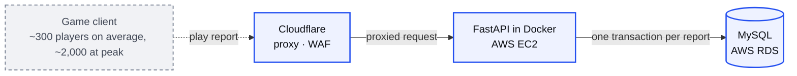

# WJMAX game server

[](https://github.com/zoocasso/wjmax-game-server/actions/workflows/ci.yml)

Play-log ingestion API of **WJMAX**, a fan-made community rhythm game: about 300 players online on average and about 2,000 at the peak of an update day. I was the sole server developer, Aug 2023 – Feb 2024.

**Write-up:** [English](https://zoocasso.github.io/en/work/wjmax/) · [한국어](https://zoocasso.github.io/work/wjmax/)



<sub>The service as it ran while the game was live (2023–2024). Solid blue: my work · grey dashed: built by someone else.</sub>

## At a glance

| | |
| :--- | :--- |
| **What** | The play-log ingestion API of **WJMAX**, a fan-made rhythm game in the Woowakgood community. Side project of two people |
| **My part** | Sole server developer: server, security layer and database. Design, deployment and operation of the live service |
| **Others** | The main developer built the game and its client |
| **Numbers** | Aug 2023 – Feb 2024 · about 300 players online on average, about 2,000 at the peak of an update day |
| **Stack** | Python, FastAPI, SQLAlchemy, MySQL, Docker, AWS EC2 and RDS, Cloudflare |
| **Run · tests** | [Run](#run) · pytest on SQLite, and on MySQL 8.0 and 8.4 in GitHub Actions |

## Key design decisions

**In the live service (2023–2024)**

- **Cloudflare in front of one server.** Game clients reached the API through Cloudflare (proxy, WAF); behind it ran FastAPI in Docker on AWS EC2, with the data in AWS RDS (MySQL). I designed, deployed and ran it alone.
- **One small request per play report.** The client sends its device id and, for every song, the play count of each of its eight charts; the server finds the song's first chart key and stores one row per chart. This request is unchanged in this repository, so the released client still works with it.

**Added in this repository**

- **No request waits for a database connection.** An earlier draft took the connection in a FastAPI dependency; in a local load test with 60 clients sending at once, 281 of 600 requests failed with a pool timeout. Now each request takes its connection inside its worker thread, after its input has been checked, and the pool can open as many connections as there are worker threads (40). CI checks that 60 clients sending at once are all answered.
- **A report is stored completely or not at all.** One transaction per report, with the input checked before a connection is taken, so malformed input is a `422` even when the database is down.
- **A retried report is stored once.** A client may send a `report_id`; a second delivery with the same id writes nothing and answers `"duplicate": true`, even when both arrive at once. The same id with different play counts is refused with `409`.
- **Hostile input is a `422`, not a crash.** `count_log` is tokenized before it is parsed (limited types, at most four levels deep), counts must fit a MySQL `INT`, and bodies over 1 MB are refused with `413`.
- **Exact matching.** Titles and ids compare byte for byte (`utf8mb4_0900_bin`), because MySQL's default collation would merge songs such as "Song" and "SONG" or "うた" and "ウタ".

## API

`POST /insert_playcount`, as the game client sends it:

```json
{"device_id": "…", "count_log": "{'playDatas': ['Sample Song*3*1*0*0*2*0*0*0']}"}
```

Each entry is a song title and the play count of each of its eight charts. An optional `"report_id"` (1–64 letters, digits, `-` or `_`) makes retries safe. The response:

```json
{"saved": 8, "unknown_titles": [], "report_id": "…", "duplicate": false}
```

Errors: `422` for malformed input, `409` for a `report_id` reused with other play counts, `413` for a body over 1 MB.

## Run

A local MySQL in Docker, with the tables from `schema.sql` and one sample song from `seed.sql`:

```bash
docker run -d --name wjmax-mysql -e MYSQL_ROOT_PASSWORD=change-me -e MYSQL_DATABASE=wjmax_db -p 3306:3306 mysql:8.4
until docker exec wjmax-mysql mysqladmin ping -h 127.0.0.1 -uroot -pchange-me --silent; do sleep 2; done
docker exec -i wjmax-mysql mysql -uroot -pchange-me wjmax_db < schema.sql
docker exec -i wjmax-mysql mysql -uroot -pchange-me wjmax_db < seed.sql
cp .env.example .env              # its DATABASE_URL points at this container
```

The server, and in a second terminal the sample client:

```bash
python3.12 -m venv .venv && . .venv/bin/activate
pip install -r requirements.txt
set -a && . ./.env && set +a      # export the settings in .env; uvicorn does not read the file
uvicorn app.main:app --reload
python3 client.py                 # in the second terminal: sends one report, answers 200 with "saved": 8
```

With Docker: `docker build -t wjmax-server .` and `docker run --env-file .env -p 8000:8000 wjmax-server`, with `127.0.0.1` in `.env` changed to `host.docker.internal` so the container reaches the MySQL container.

Tests: `pip install -r requirements-dev.txt` and `python -m pytest -q`. Set `TEST_DATABASE_URL` to an empty MySQL database whose name ends in `test` to run them on MySQL as well; the tests drop and recreate the tables there and refuse any other database name.

<details>
<summary><b>Every design detail</b></summary>

- **One transaction per request.** A report is stored completely or not at all. Input is checked before the request takes a database connection, so malformed input is a `422` even when the database is down.
- **Devices are registered once.** The first report creates the device (`INSERT IGNORE`) and later reports keep its first-seen time.
- **One lookup per report.** The first chart key of every song in a report comes from a single grouped query.
- **A connection for every worker thread.** FastAPI runs each request in one of 40 worker threads. The request takes its connection in that thread, after its input has been checked, and the pool can open 40 connections, so no request waits for one. An earlier draft of the code in this repository took the connection in a FastAPI dependency, which starved the pool: in a local load test with 60 clients sending at once, 281 of 600 requests failed with a pool timeout.
- **Every report is a row.** `report_tb` records each report under `(device_id, report_id)` with the time the server received it (`reported_at`), and every play-count row points to its report, so a device's snapshots can be told apart and ordered.
- **A retried report is stored once.** A client may send its own `report_id`; a second delivery with the same id is answered with `"duplicate": true` and writes nothing, even when both arrive at once (the key makes the second `INSERT IGNORE` wait for the first). The game client as it was released sends no id, so the server assigns one and its retries are stored as separate reports. A `report_id` the device already used, sent with different play counts, is refused with `409`: `report_tb` keeps a SHA-256 of each report's parsed play counts, so a retry still matches when it is quoted differently.
- **One row per chart.** Entries that name the same song in one report, a title twice or a title and its alias (aliases come from the `TITLE_ALIASES` setting; [`client.py`](client.py) sends one title twice), are added up, so each chart gets one row per report. A sum that no longer fits a MySQL `INT` is a `422`.
- **Validated input.** `count_log` is tokenized before it is parsed and may hold only objects, lists, strings, numbers and keywords, at most four levels deep, so hostile input is a `422` instead of a crash inside the JSON or Python parser. Each entry is a non-blank title and eight counts written in ASCII digits that fit a MySQL `INT`. Bodies over 1 MB are refused with `413`: at once when `Content-Length` says so, and otherwise as soon as a chunked body passes 1 MB. Songs that are not in `music_tb` are skipped and returned in `unknown_titles`. `device_id` may not contain spaces, line breaks or other control characters, because it is written to the log. Unknown titles are logged as a count and the first few, cut short and escaped. Text that is not valid Unicode (a lone surrogate) is a `422`, and a `422` names the field and the problem without echoing the input back.
- **Exact matching.** Titles and ids compare byte for byte (`utf8mb4_0900_bin`). MySQL's default collation ignores case, accents and kana, which would merge songs such as "Song" and "SONG" or "うた" and "ウタ" and treat report `R-1` as a retry of `r-1`.
- **No authentication.** The released game client sends no credentials, so anyone who knows the URL can post a report under any `device_id`. Input validation, the body limit and Cloudflare in front of the server are what bound abuse; reports are not proof of who played.
- **Starts without the database.** Tables are declared in code ([`schema.sql`](schema.sql) has the DDL), the engine is created on first use, and stale connections are checked before use. `GET /healthz` reports database trouble as `503`.
- **No secrets in the image.** Settings come from the environment at run time, the container runs as a non-root user, and the API docs are off unless `ENABLE_DOCS=1`.
- **Tested.** [`tests/`](tests/) covers parsing and the API. GitHub Actions runs them on SQLite and again on MySQL 8.0 and 8.4 with the tables from `schema.sql`, which also checks that `schema.sql` matches the code (column types and collations, nullability, keys, indexes), that titles and ids compare exactly, that concurrent retries are stored once and that 60 clients sending at once are all answered. The MySQL jobs fail if any test is skipped.

</details>

---

<sub>This code is a 2026 cleanup and rewrite of the 2023–2024 service, so the commits are dated 2026.</sub>
